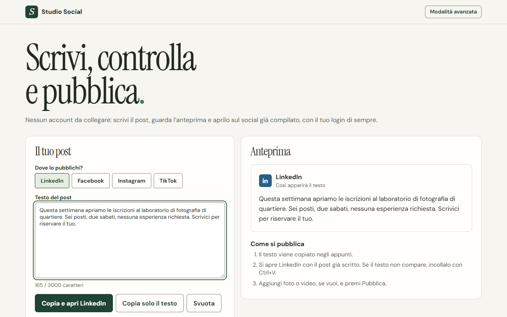
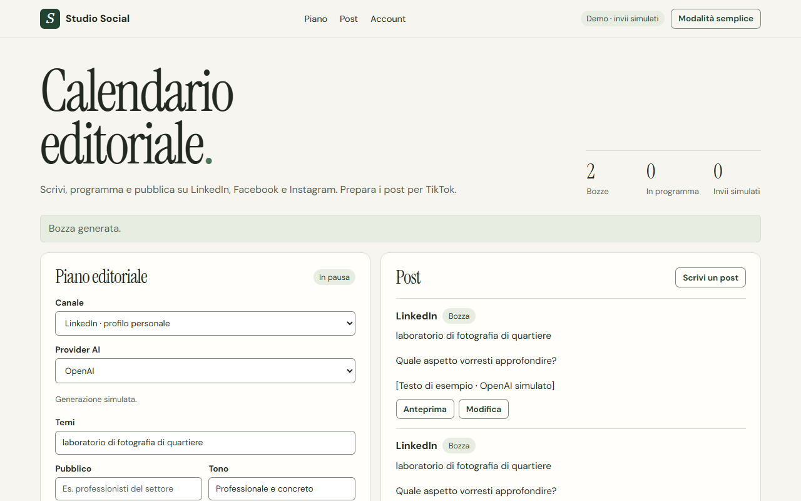
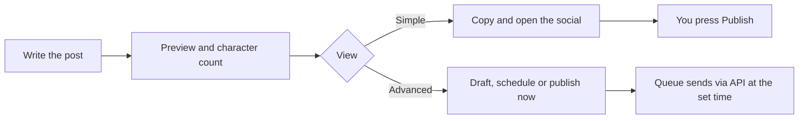
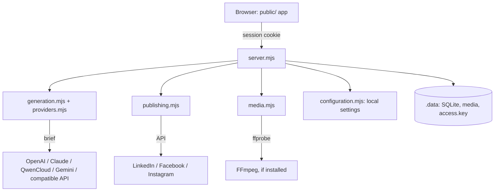

# Studio Social

A local web app for one person. It writes social posts from a brief, keeps editable drafts, and publishes to a LinkedIn profile, a Facebook Page or an Instagram professional account. For TikTok it prepares and exports posts. The recurring plan uses the `Europe/Rome` time zone; single posts use the time zone shown by your device.

The interface is available in Italian and English (switch with the IT/EN selector in the top bar; the first visit follows your browser language). Generated posts are written in the language selected when the plan is saved or the draft generated. This README is in English.

Requirements: [Node.js](https://nodejs.org/) 24 or later. No runtime dependencies.

## Two views

| Simple view (default) | Advanced view |
| --- | --- |
|  |  |

**Simple view** is for people who only have a personal login on the social. No account to connect, no key, no scheduling. Choose where to publish, write the text and check the preview with the character count for that social. **Copia e apri** (copy and open) copies the text and opens the social in your own, already signed-in browser. On LinkedIn the post arrives prefilled; on Facebook, Instagram and TikTok you paste with Ctrl+V. Add photos or videos on the social and press Publish yourself: publishing stays your own action. The draft and the chosen social are remembered in this browser. If an AI provider is configured, **Scrivi con l’AI** writes the post from a short request within the limit of the chosen social; with **Abilita web** it also reads the links in the request (OpenAI, Claude and QwenCloud only).

**Advanced view** (button at the top right) is for business profiles and Pages with API access: recurring plan, scheduling, automatic publishing and account connection. **Migliora i campi con l’AI** turns generic words in the plan fields into complete texts for you to check. The choice is remembered in the browser.



## Quick start

```sh
npm start
```

On Windows you can also run `run.ps1` (see below). The first time, in each browser, open the address with the key printed in the terminal (`http://localhost:3000/?key=…`): it sets a session cookie, and after that <http://localhost:3000> is enough. The key is in `.data/access.key`; to change it, delete the file and restart.

Demo mode needs no external dependency, key or account and uses a separate database. Texts are samples and sends are simulated. To try the flow, enter a theme, choose **Genera una bozza**, open **Modifica** and choose **Programma** or **Pubblica ora**.

### `run.ps1` (Windows)

`run.ps1` checks Node.js 24+, installs runtime dependencies (dev tools are skipped), creates `.env` from `.env.example` on first run (demo mode) and starts the server. The browser opens on the login address. When Studio Social instances are already running, an arrow-key menu lists them so you can stop them, open them or pick another port (arrows, 1–9, Enter and Esc).

| Option | Effect |
| --- | --- |
| `-Port <n>` | Listen on this port (overrides `PORT` in `.env`) |
| `-Live` | Real generation and publishing for this run (`DEMO=false`) |
| `-NoBrowser` | Do not open the browser |
| `-WithDevTools` | Also install the Playwright test tooling |
| `-StopExisting` | Stop every running instance without asking |
| `-NoMenu` | Skip the start menu |

The menu keys have not been verified in a real interactive terminal yet.

## How it fits together



The server listens only on the local machine, is meant for a single process and user, and runs the scheduler every 15 seconds while it is running.

## Configuration in the app

Open **Account** in the dashboard. Each social card has a guide, links to the official portals and, when available, fields to save credentials. **Applica ambiente** switches between demo and real mode and back. The two modes keep separate drafts, attachments and calendars. When you switch to real mode, any calendar already set for that mode resumes.

- **LinkedIn.** Register the callback shown in the profile guide, save Client ID and Client Secret and enable local HTTPS. You can generate a certificate from the app if OpenSSL is available, or paste an existing PEM certificate and key. The browser or the system must accept the `localhost` certificate to complete the OAuth return. The HTTPS managed by the app normally uses the port after the main one; the guide always shows the actual address.
- **Facebook.** Use the ID and token of a Page you can manage. The guide says where to get the token and which permissions to request. The connection check identifies the Page. Meta verifies write permissions when you send the first post.
- **Instagram.** Link the professional account to a Facebook Page. You can reuse the same Page and token if they have Instagram permissions, or provide dedicated credentials. Reels are uploaded directly. For JPG photos, Meta must reach a public URL: in the guide, give the local folder already served by an HTTPS host and its URL. Configure the host without a public index and with cache disabled. The app removes the temporary copy when the attempt ends. After a sudden stop, check the public folder.
- **TikTok.** The guide explains how to export the media and copy the caption to publish in the TikTok app. The [Direct Post rules](https://developers.tiktok.com/docs/en/content-sharing-guidelines) exclude tools reserved for your own or your team's accounts.

### AI providers

Open **Account → Configura i provider AI**, choose the service and save the API key. For live generation, switch to real mode and choose the provider in **Piano editoriale → Provider AI**. **Genera una bozza** uses the current choice; **Salva piano** stores it for recurring generation. You can also write and schedule by hand without any AI provider.

| Service | Settings |
| --- | --- |
| [OpenAI](https://developers.openai.com/api/reference/resources/responses/methods/create) | OpenAI key and optional model. |
| [Claude](https://platform.claude.com/docs/en/api/messages/create) | Anthropic key and optional model. |
| [QwenCloud](https://docs.qwencloud.com/api-reference/chat/openai-chat) | Key for the region matching the endpoint. The default endpoint is Singapore. |
| [Gemini](https://ai.google.dev/gemini-api/docs/openai) and [Antigravity](https://ai.google.dev/gemini-api/docs/antigravity-agent) | Gemini API key. Antigravity uses the managed agent in preview. |
| Compatible API | Key, model and an HTTPS URL that supports Chat Completions and Bearer authentication. |

The selected AI service receives the brief and short excerpts of recent posts. Generation may incur API costs. Keys and tokens stay in the app's local data and the browser does not show them after saving.

## Photos and videos

To upload new media, install [FFmpeg](https://ffmpeg.org/download.html) and check `ffprobe -version`. You can add one attachment per post, preview it, and remove or replace it in the editor. Use **Anteprima** on a post card or in the editor to review the text, even before saving. The dialog lets you show or hide the attachment and play videos the browser supports; you can download the file even if the browser cannot play it. The recurring plan reuses the selected attachment. To publish automatically on Instagram the plan must have one.

| Channel | Photos in Studio Social | Videos in Studio Social |
| --- | --- | --- |
| LinkedIn | JPG/PNG up to 8 MB, under 36,152,320 pixels | MP4 H.264 between 75 KB and 100 MB, 3 s to 30 min. Check that your app has access to the Videos and Posts APIs. |
| Facebook | JPG/PNG up to 10 MB. Meta recommends PNG up to 1 MB for quality. | MP4/MOV H.264 or H.265 up to 100 MB. |
| Instagram | JPG up to 8 MB, from 4:5 to 1.91:1. Meta resizes the width to 320–1440 px. | Reel MP4/MOV H.264 or H.265 up to 100 MB, 3 s–15 min, 23–60 fps, width up to 1920 px. 9:16 recommended. |
| TikTok | JPG/WebP up to 20 MB with short side up to 1080 px, for export. | MP4/MOV H.264 or H.265, or WebM VP8/VP9, up to 100 MB and 10 min, 23–60 fps, sides 360–4096 px. In the TikTok app the available length depends on the account. |

For Reels, export with Fast Start (`moov` atom before `mdat`) and disable edit lists. Use progressive 4:2:0 video with closed GOP and variable bitrate up to 25 Mbps. If present, use AAC audio at 128 kbps, up to 48 kHz, mono or stereo. The app checks the container structure and the metadata it can read; GOP and peak bitrate are subject to Meta's own verification.

The table limits are the app's. The [LinkedIn Videos API](https://learn.microsoft.com/en-us/linkedin/marketing/community-management/shares/videos-api?view=li-lms-2026-10) allows up to 500 MB, the [IG User Media v27.0 reference](https://developers.facebook.com/documentation/instagram-platform/instagram-graph-api/reference/ig-user/media) allows up to 300 MB for Reels, and the [TikTok Media Transfer Guide](https://developers.tiktok.com/docs/en/content-posting-api-media-transfer-guide) documents up to 4 GB per video. The [Page Photos API](https://developers.facebook.com/docs/graph-api/reference/page/photos/) also accepts BMP, GIF and TIFF.

## Using the calendar

- Fill in themes, audience, tone and reference material. **Genera una bozza** lets you try the brief before turning the plan on.
- The plan allows at most one recurring post per date. If the service starts after the configured time, it catches up the recurrence of the current day; earlier days are skipped.
- **Crea e pubblica automaticamente** generates the post and queues it at the planned time. **Crea bozze da rivedere** leaves the result in the post list. Pause stops new recurrences. Posts already queued are handled one by one with **Modifica** → **Salva bozza**.
- Keep `npm start` running when you want the calendar to work; the browser can be closed. Scheduled posts left in the queue go out when the service restarts. If the outcome of a send is uncertain, check on the social and record the outcome in the app before rescheduling: an uncertain send is never repeated automatically.
- The app listens only on the local machine and is meant for a single process and user. The `.data/` folder and any previous `.env` hold credentials or private data: keep them out of Git, shared archives and public backups. 24/7 operation needs an always-on machine.

## Separate browser window (optional)

```bash
npm run browser
```

Opens a separate window (Electron, fetched on demand with `npx`, no new dependency) with Studio Social and a **Socials** menu for LinkedIn, Facebook, Instagram and TikTok. You sign in on the social's own page; Electron keeps the cookies in `.data/browser` (this user's folder, Git-ignored) so the login lasts. Studio Social never reads, fills or automates it. Only `https` pages and the local server can be opened in the window, and permission prompts (camera, location, notifications) are denied. Start the server first (`npm start` or `run.ps1`). Not verified on a real display in this repository's tests.

## Updating an existing copy

Stop the app. Extract the new version into a new folder and move the `.data/` folder over from the old copy to keep drafts, attachments and the calendar. If you used a `.env`, you can copy it to keep earlier settings; changes saved from the dashboard take precedence. Start the app with `npm start`.

## Tests

```sh
npm test            # 6 unit tests
npm run test:e2e    # 28 Playwright tests (demo mode, Microsoft Edge by default)
```

`npm run test:e2e` needs `npm install` first and FFmpeg for the media tests. Set `E2E_CHANNEL=chrome`, or an empty value to use Playwright's own Chromium.

## Limits

- Real providers, OAuth flows and live mode have only been exercised with mocks and demo mode, never with real accounts.
- Publishing with a personal login is assisted (copy and open); the app never automates it. The optional window below only shows the socials' own pages.
- The interface translation is done in the browser from Italian source strings; plan defaults saved earlier (for example the tone text) stay in the language they were saved in.

## License and credits

[MIT](LICENSE). Third-party components and fonts are listed in [CREDITS.md](CREDITS.md). Changes are in [CHANGELOG.md](CHANGELOG.md).
